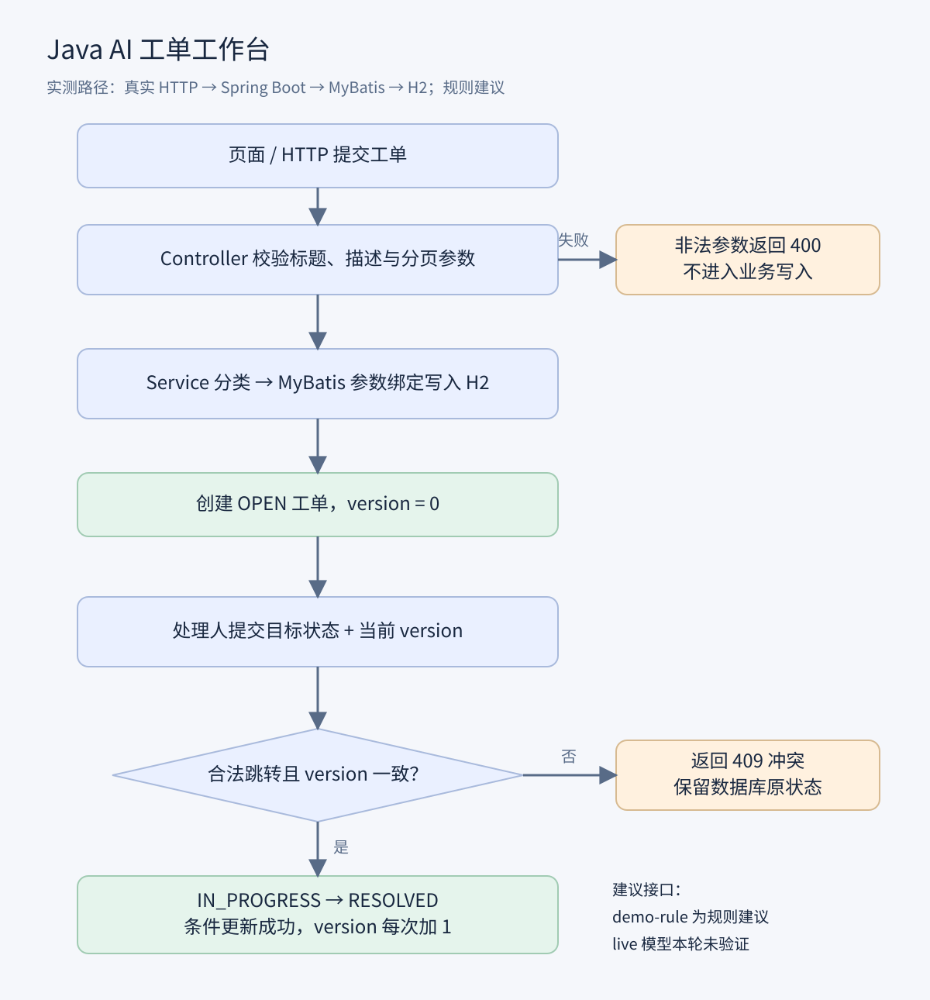
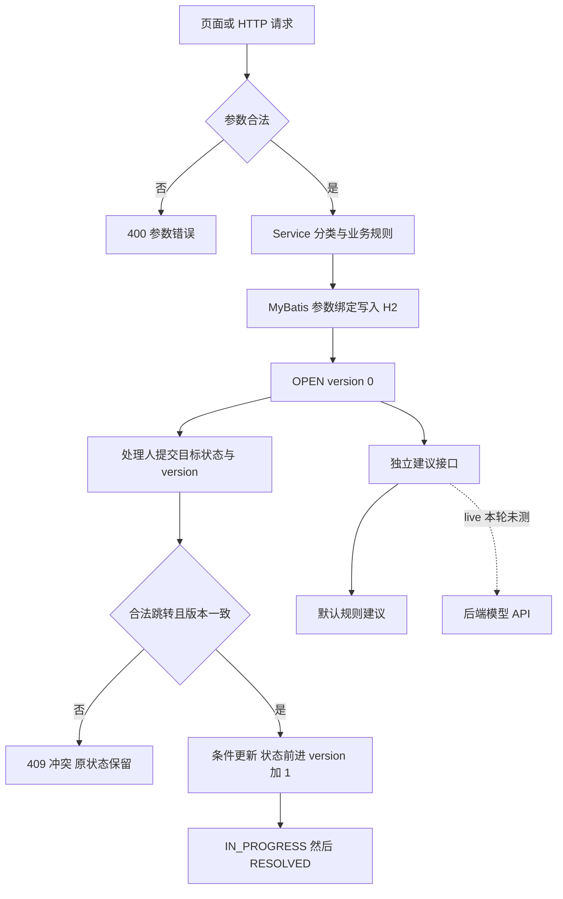

# 业务案例验收 ai-ticket-workbench

案例依据常见业务情境设计，输入为模拟数据，以下结果来自实际执行，不代表生产环境事故或真实用户效果。

本轮结果：**5/5 通过**。原始输出见 [results.json](../examples/results.json)，执行脚本见 [verify_cases.py](../examples/verify_cases.py)。

## 复现方式

先启动独立测试实例，再在另一个终端运行脚本：

```bash
mvn -B verify
java -jar target/ai-ticket-workbench-1.0.0.jar --server.port=8087 --spring.datasource.url=jdbc:h2:mem:businesscases
# 另一个终端，Python 3.11+
python examples/verify_cases.py --base-url http://127.0.0.1:8087
```

脚本会创建带 case 前缀的测试工单；请使用演示实例。使用内存数据库，停服后清空。并发案例只要求一方成功，不依赖线程胜出顺序。

## JAVA-01 商城慢查询工单，从创建到解决的完整闭环

场景：商城商品列表慢查询，需要从建单、建议、接单到结单形成闭环。

操作：POST 创建数据库工单；调用建议；依次 PATCH 到 IN_PROGRESS 和 RESOLVED。

预期：201 创建成功；规则建议含 EXPLAIN；状态依次前进且 version=0/1/2。

实测：实际 HTTP 全链路通过，最终 RESOLVED、version=2。规则建议不是模型生成。

## JAVA-02 两个客户端持相同 version 同时接单，仅一方成功

场景：两名支持人员打开相同版本的工单并同时接单。

操作：两个线程并发 PATCH，相同 ID、version=0、目标 IN_PROGRESS。

预期：只能一个 200，另一个 409；最终 version=1。

实测：收到 [200,409]，数据库状态 IN_PROGRESS、version=1，避免覆盖更新。

## JAVA-03 跳过处理中直接结单被拒绝，数据库状态保持不变

场景：误操作尝试跳过处理中，从 OPEN 直接结单。

操作：新建部署失败工单，然后直接 PATCH 为 RESOLVED、version=0。

预期：409 Invalid status transition，原状态 OPEN、version=0。

实测：返回 409，数据库未推进状态。

## JAVA-04 多条工单分页，返回稳定倒序且两页无重复

场景：支持人员翻页处理多条工单，要求稳定排序且无重复。

操作：新增 6 条样例，查询第 1、2 页，每页 5 条。

预期：两页不重叠、ID 倒序，顺序一致。

实测：在空内存数据库本轮运行中共 9 条；第一页 [9,8,7,6,5]，第二页 [4,3,2,1]。验证的是静态数据分页，未验证翻页期间新增或删除的情况。

## JAVA-05 非法请求被拒绝，SQL 特殊字符仅作为工单文本

场景：客户端传入空标题、超大页大小、不存在 ID，以及带 SQL 特殊字符的标题。

操作：分别请求空标题、size=101、缺失工单，并保存包含 DROP TABLE 的标题。

预期：前 3 项返回 400/400/404；特殊字符作为普通文本保存，列表仍可查。

实测：收到 400/400/404，后续列表 HTTP 200；没有执行输入中的 SQL。

## 业务流程图





## 验证范围

本轮不消耗模型 API，不验证真实生成效果、供应商网络异常、Docker 部署或生产性能。案例脚本任何断言失败都会返回非零退出码。样例全部通过只说明这些路径可复现。
